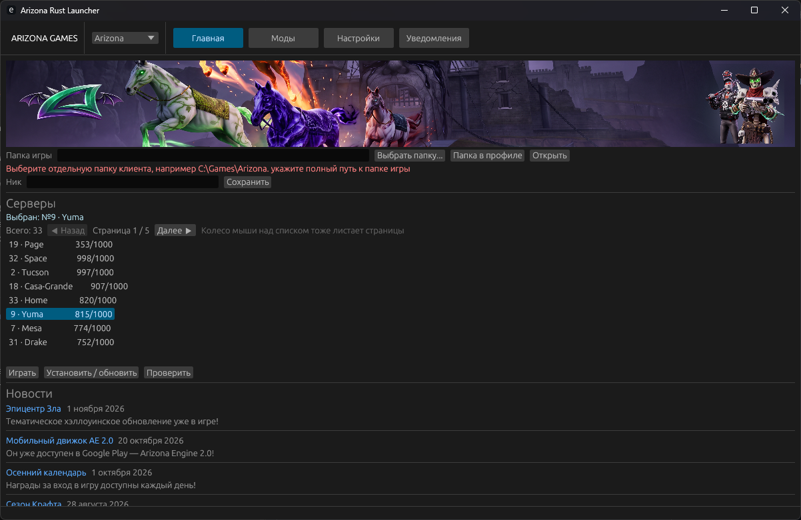

# Arizona Rust Launcher

Неофициальный лаунчер Arizona Games для Windows, написанный на Rust. Интерфейс работает на `egui` и запускается без Electron и окна командной строки.



Проект находится в разработке. Он умеет получать список проектов и серверов, загружать и проверять файлы игры по манифесту, запускать поддерживаемые игры, управлять модами и показывать новости. Для Trilogy и Village соответствующая кнопка открывает страницу проекта в браузере.

Лаунчер не содержит файлы игр. Arizona Games и названия игр принадлежат их правообладателям; этот проект не связан с ними и не является официальным клиентом.

## Скачать и установить

Если для версии опубликован установщик, скачайте `ArizonaRustLauncher-<версия>-Setup.exe` на странице Releases этого репозитория. Он устанавливает лаунчер для текущего пользователя, создаёт пункт меню «Пуск» и деинсталлятор. Ярлык на рабочем столе можно выбрать при установке. Права администратора не требуются. Установщик и исполняемый файл пока не имеют цифровой подписи.

При первом запуске выберите проект, укажите ник, сервер и отдельную папку для игры. Рекомендуемая папка находится в `%USERPROFILE%\Games`. Не выбирайте `Program Files`, если у вашего пользователя нет прав записи. Перед загрузкой лаунчер проверяет папку и показывает план установки; при починке перечисляет пути, которые будут удалены. Данные игры скачиваются отдельно и могут занимать много места.

Закрытие окна сворачивает лаунчер в системный трей. Пункт «Выход» в трее завершает процесс. Повторный запуск открывает окно уже работающего экземпляра.

## Сборка из исходников

Требуются Windows x64 и установленный [Rust toolchain](https://rustup.rs/). В корне проекта выполните:

```powershell
cargo build --release --locked
.\target\release\arizona-rust-launcher.exe
```

Для сборки установщика дополнительно нужен [Inno Setup 7](https://jrsoftware.org/isinfo.php):

```powershell
.\installer\build-installer.ps1 -Iscc 'C:\Program Files (x86)\Inno Setup 7\ISCC.exe'
```

Готовый установщик будет в `target\installer`. Путь к `ISCC.exe` укажите согласно своей установке.

## Проверка

```powershell
cargo test --locked
```

Для просмотра плана установки без записи файлов используйте отладочную сборку:

```powershell
cargo build --locked
.\target\debug\arizona-rust-launcher.exe --dry-run arizona C:\Games\Arizona .\fixtures\arizona_game.json
```

Снимки JSON в `fixtures` нужны для тестов и для начального отображения данных до ответа API. Они могут устаревать; при подключении лаунчер обновляет сведения через серверы проектов.

## Настройки и данные

Настройки хранятся в `%APPDATA%\arizona-rust-launcher\settings.json`. При первом запуске лаунчер переносит распознанные параметры из `%APPDATA%\arizona-launcher\settings.json`, если он существует. Пароль не переносится. Удаление лаунчера не удаляет настройки или файлы игры.

Лаунчер загружает манифесты, изображения и файлы игры из сервисов, используемых проектами Arizona Games. Перед установкой проверяйте выбранную папку и список операций. Для каждого проекта используйте отдельную папку.

При запуске поддерживаемой игры лаунчер может вычислить SHA-256 от системного `MachineGuid` и передать результат игровому процессу в параметре `-userId`. Это повторяет способ формирования идентификатора исходного лаунчера.

## Ограничения

- Это самостоятельная реализация, а не точная копия внешнего вида и всех функций Electron-лаунчера 0.0.144.
- Системные toast-уведомления и автоматическое обновление самого Rust-лаунчера ещё не реализованы. Кнопка релиза открывает страницу релизов исходного лаунчера.
- Полная загрузка игры, все варианты её запуска и установка драйверов не проверены на реальной игровой установке. Проверены тесты, разбор снимков API и установка лаунчера в отдельный каталог.
- Установщик и бинарник не подписаны сертификатом издателя.

## Устройство проекта

- `src/model.rs`, `src/net.rs` — модели данных и запросы к API.
- `src/plan.rs`, `src/safety.rs` — план операций и проверка путей.
- `src/install.rs` — загрузка, проверка хеша, отмена и замена файлов.
- `src/settings.rs`, `src/mods.rs` — настройки и моды.
- `src/launch.rs`, `src/drivers.rs`, `src/identity.rs` — запуск игры и системные интеграции.
- `src/main.rs` — графический интерфейс, трей и состояние приложения.
- `installer/` — сценарий Inno Setup и скрипт сборки.

Реализация основана на анализе поведения версии 0.0.144. Исходный код Electron-приложения, файлы игр и установщики драйверов в этот репозиторий не входят.

## Участники

Проект ведёт [maxutkomartinnes](https://github.com/maxutkomartinnes). В разработке и документации помогал OpenAI Codex (ChatGPT). Подробнее — в [CONTRIBUTORS.md](CONTRIBUTORS.md).
